<!-- ===================== ANIMATED HEADER ===================== -->
<p align="center">
  <a href="https://new-portofolio-one.vercel.app/">
    
  </a>
</p>

<p align="center">
  <a href="https://git.io/typing-svg">
    
  </a>
</p>

<p align="center">
  <a href="https://new-portofolio-one.vercel.app/"></a>
  <a href="https://linkedin.com/in/rizk1pratama"></a>
  <a href="mailto:Rizki191220@gmail.com"></a>
  <a href="https://instagram.com/rizki.kii"></a>
</p>

<p align="center">
  
</p>

---

##  About Me


I'm a **Frontend Developer from South Jakarta, Indonesia 🇮🇩** who loves turning complex, data-heavy requirements into clean and usable interfaces.

Most of my work is building **large-scale web applications for Indonesian government & education institutions**: e-budgeting platforms, education administration tools, supervision systems, and procurement management.

- 🔭 **Currently** — Senior Frontend Developer @ **Dua Mirada Creation** (client: *Kemendikdasmen*)
- 🎓 **Also** — Frontend Developer placed at **Universitas Terbuka**
- 🧭 **Recently** — stepping into a **Project Manager** role on an ongoing project
- 🌱 **Learning** — Micro Frontends, BFF architecture, Node.js, WebSocket
- 🌏 **Open to** — remote frontend opportunities

<br clear="right"/>

<details>
<summary><b>💼 Click to see my experience</b></summary>
<br/>

| Role | Company | Highlights |
| --- | --- | --- |
| **Senior Frontend Developer** | Dua Mirada Creation · *Kemendikdasmen* | Ministry-level education platforms (React, TS, MUI) |
| **Frontend Developer** | Kharizma Zona Kreasi · *Universitas Terbuka* | Academic & institutional web systems |
| **Frontend Developer** | Bumi Amartha · *CIMB Niaga* | HRIS application |
| **Frontend Developer** | M-Knows Consulting | LMS / LXP platform, mentored interns |

🎓 **Informatics Engineering** — Mercubuana University
</details>

<details>
<summary><b>🧑‍💻 Click to see how I'd describe myself in code</b></summary>
<br/>

```ts
const rizki = {
  role: "Senior Frontend Developer",
  location: "South Jakarta, Indonesia 🇮🇩",
  stack: ["React", "TypeScript", "MUI", "Vite", "Next.js"],
  dataLayer: ["TanStack Query", "Axios"],
  forms: ["React Hook Form", "Zod"],
  currentlyLearning: ["Micro Frontends", "BFF", "Node.js", "WebSocket"],
  funFact: "I think I'm funny 😄",
  openToWork: true,
};
```
</details>

---

##  Tech Stack

<p align="center">
  <a href="https://skillicons.dev">
    
  </a>
</p>

<p align="center">
  
  
  
  
  
  
</p>

<details>
<summary><b>🧰 Click to see backend, database & tools</b></summary>
<br/>
<p align="center">
  
</p>
</details>

---

##  Featured Projects

| Project | Description | Stack |
| --- | --- | --- |
| 📊 **E-Budgeting Platform** | Large-scale budgeting system for an Indonesian institution, with complex forms, tables & approval flows | React · TS · MUI · TanStack Query |
| 🏫 **Pengawasan TKA** | Micro frontend for supervising academic competency test (TKA) proctoring, with BFF & shared cookie auth | React · Vite · TS · MUI |
| 🧵 **Dame Ulos** | E-commerce site + admin panel for traditional Batak Ulos textiles | Next.js · MUI |

<p align="center">
  <a href="https://new-portofolio-one.vercel.app/">
    
  </a>
</p>

---

##  GitHub Stats

<p align="center">
  
  
</p>

<p align="center">
  
</p>

<details>
<summary><b>📈 Click to see my contribution activity graph</b></summary>
<br/>

</details>

### 🐍 Watch the snake eat my contributions

<!-- Generated daily by .github/workflows/snake.yml; adapts to light/dark mode -->
<picture>
  <source media="(prefers-color-scheme: dark)" srcset="https://raw.githubusercontent.com/rizki1912/rizki1912/output/github-snake-dark.svg" />
  <source media="(prefers-color-scheme: light)" srcset="https://raw.githubusercontent.com/rizki1912/rizki1912/output/github-snake.svg" />
  
</picture>

---

## 💭 Dev Quote of the Moment

<p align="center">
  
</p>

<p align="center">
  Thanks for stopping by! ⭐ Feel free to explore my repositories.<br/>
  
</p>


